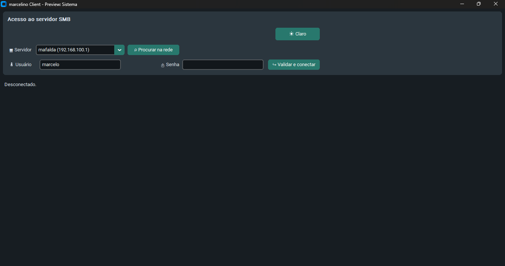
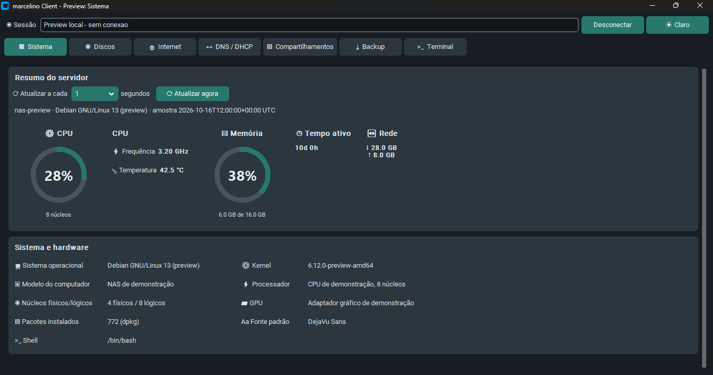
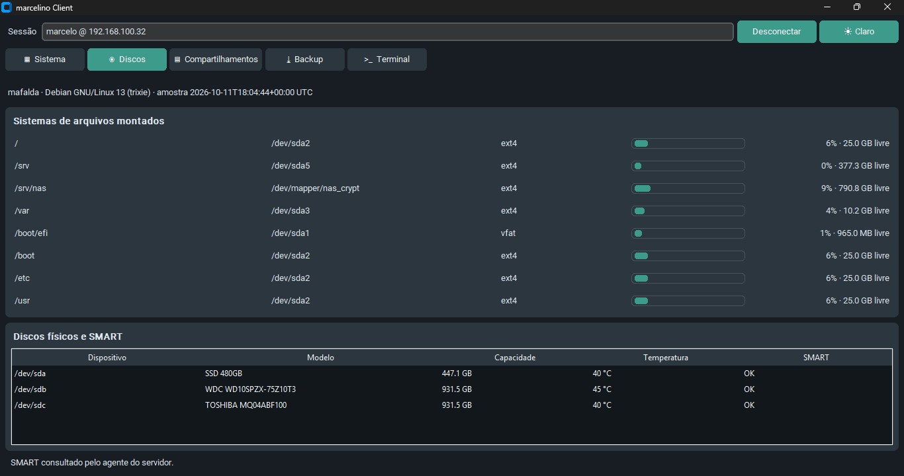
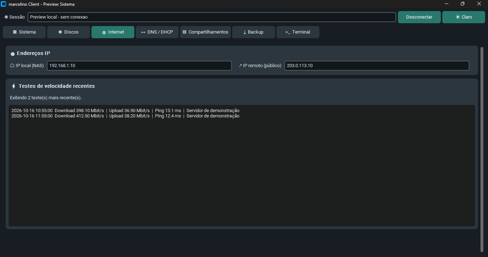
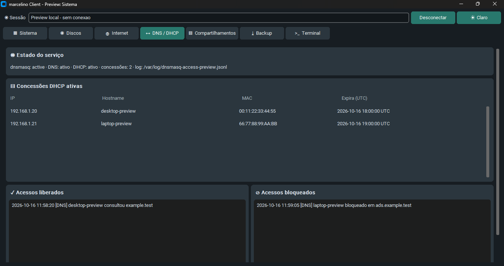
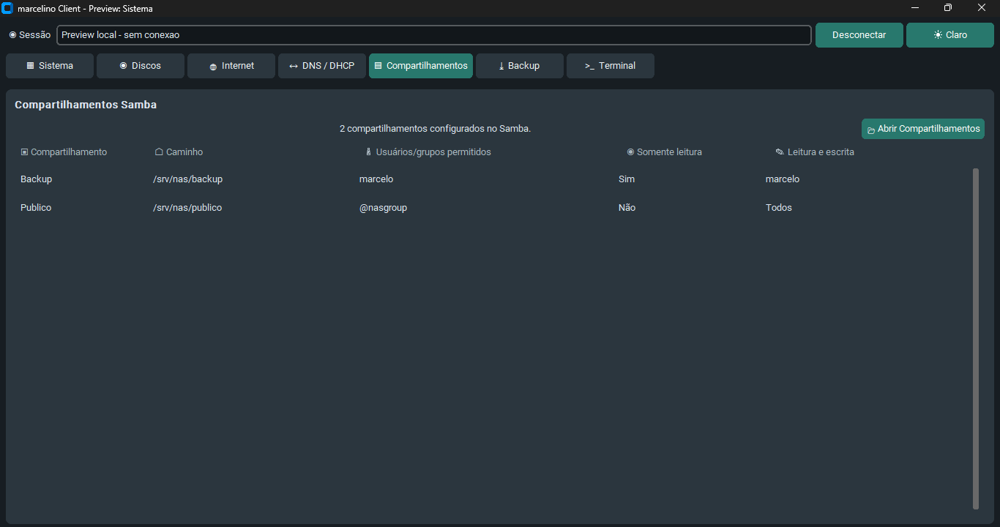
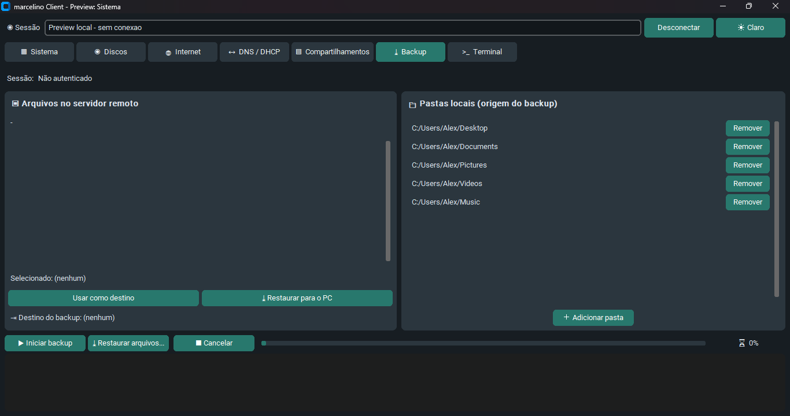
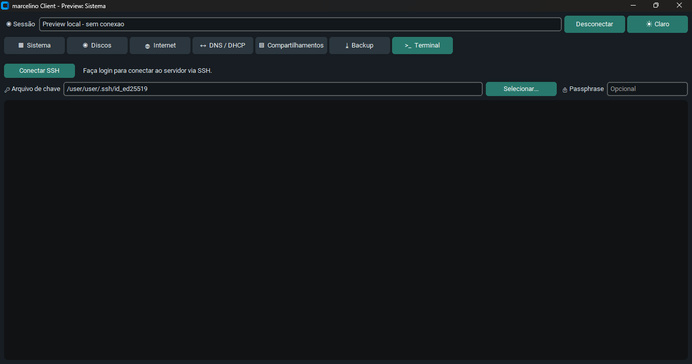

# Marcelino NAS and Client

[English](README.md) | [Português (Brasil)](README.pt-BR.md)

This project includes a Debian NAS setup script, an agent that publishes server statistics to a Samba share, and the Windows `marcelino Client` application.
An alternative cross-platform .NET version of Marcelino Client is available for Windows on [MarcelinoClientDotNet](https://github.com/marceloh220/MarcelinoClientDotNet)

## Components

| Component | File | Purpose |
|---|---|---|
| NAS setup | `nas-setup.sh` | Configures a static IP, storage, Samba, network discovery, NTP, DNS/DHCP with ad/tracker blocking, and a firewall. |
| Speed test | `nas-speedtest.py` | Measures download, upload, and ping; logs results as JSONL, lists tests, and generates charts. |
| Statistics agent | `marcelinoServer.py` | Publishes server metrics, RAID array status, and Samba share rules as JSON. |
| systemd service | `marcelinoServer.service` | Runs the agent after system startup. |
| Agent installer | `install_marcelinoServer.sh` | Compatibility wrapper for `nas-setup.sh --marcelino-server`. |
| Web dashboard | `marcelinoWeb.py`, `marcelinoWeb.service` | Login-protected web server displaying metrics published by the agent, including RAID status and synchronization, available on the local network. |
| Windows client | `marcelinoClient.py` | Interface for server metrics, disks and RAID, shares, backup/restore, and an SSH terminal. |
| Client preview | `preview_marcelinoClient.py` | Opens a tab with generic local data and no server connection. |
| Client installer | `install_marcelinoClient.ps1` | Installs dependencies, builds the executable, and creates shortcuts. |

## Configure the NAS

`nas-setup.sh` is intended for Debian and must be run as root. Review the available options before selecting the setup steps:

```bash
sudo bash nas-setup.sh --help
```

Each service option installs its dependencies, configures the service, and opens only its required UFW ports. Options can be run separately or combined:

| Option | What it configures |
|---|---|
| `--network` | Configures the static IP `NAS_IP`/`NAS_PREFIX` on the interface (NetworkManager or `/etc/network/interfaces`, with a backup at `interfaces.orig`). The current SSH connection may drop; reconnect using the new IP. |
| `--raid` | Creates the RAID with `mdadm` and updates the boot configuration. |
| `--storage` | Formats and mounts the volume; can configure LUKS encryption and automatic unlocking. |
| `--user` | Creates missing accounts for the primary user (`USER_NAME`, password `USER_PASSWORD`) on the system and in Samba; preserves existing home directories and passwords, and ensures membership in the Samba group. This step is also run by the Samba, dashboard, and speed-test steps. |
| `--samba` / `--uninstall-samba` | Installs/configures Samba and opens its ports; uninstalling stops the service and removes the package while preserving shares and files. |
| `--discovery` / `--uninstall-discovery` | Configures/removes Avahi and WS-Discovery, including their firewall ports. |
| `--ntp` / `--uninstall-ntp` | Configures/removes chrony as the LAN time server, including the NTP port. |
| `--dns` / `--uninstall-dns` | Configures/removes dnsmasq for LAN DNS and DHCP (see below), restoring the `resolv.conf` backup when removed. |
| `--speedtest` / `--uninstall-speedtest` | Installs/removes the command and speed-test/chart timers; existing logs and charts are preserved. |
| `--marcelino-server` / `--uninstall-marcelino-server` | Installs/removes the metrics agent without opening ports; configuration and existing JSON are preserved on removal. |
| `--web` / `--uninstall-web` | Installs/removes the dashboard and its firewall rule; users, certificates, and persistent configuration are preserved. |
| `--anytype` / `--uninstall-anytype` | Configures/removes the Anytype service in Docker and its daily backup timer; data and backups are preserved, and Docker is disabled/removed only if there are no other active containers. |
| `--syncthing` / `--uninstall-syncthing` | Installs/removes Syncthing as the primary user's service, with LAN synchronization ports; configuration, identity, and synced folders are preserved. |
| `--ssh` / `--uninstall-ssh` | Installs/configures or removes the SSH server, managed settings, and the `SSH_PORT` rule. Uninstalling ends remote SSH access. |
| `--dlna` / `--uninstall-dlna` | Installs/removes MiniDLNA and opens/closes SSDP and the `DLNA_PORT`; media, database/cache, and logs are preserved. |
| `--all` | Configures networking, RAID, storage, the user, and all services, including SSH, Syncthing, and DLNA. It does not uninstall anything. |

Uninstall options also accept the misspelled `--unistall-*` form for compatibility. There is no RAID or storage uninstall option: no removal option deletes partitions, changes LUKS, unmounts volumes, or disables RAID arrays. The firewall is not reset; only rules for the selected step are changed.

Options are edited in the **CONFIGURATION** section at the top of the script. The supplied values include:

- RAID 1 mirror using `/dev/sdb` and `/dev/sdc`, created as `/dev/md0`.
- Configurable filesystem in `RAID_FILESYSTEM`: `ext4` (default), `xfs`, or `btrfs`.
- Volume at `/srv/nas`; LUKS enabled on `/dev/md0`, with the `nas_crypt` mapping, keyfile `/etc/nas.key`, and automatic unlocking.
- Applications in `APP_STORAGE` (default `/srv/app`): Monitor, Anytype, Syncthing configuration, and DLNA database/cache. This path is not automatically on the RAID or inside LUKS; configure a separate mount or use a path inside the volume if you need that protection.
- Shares `Publico`, `Privado`, `Backup`, `Midia`, `Monitor`, and the primary user's share (`USER_NAME` with its first letter capitalized).
- `Publico` allows guests; `Backup` and `Midia` use the `nasgroup` group; `Privado` and the user's share are restricted to `USER_NAME`.
- Primary user: `USER_NAME` and `USER_PASSWORD` (replace `sua_senha_aqui`; at least 8 characters for new accounts). If `USER_PASSWORD=""`, the password is prompted for interactively in the terminal, without echoing typed characters, when needed to create accounts or configure web login. For non-interactive runs, set the variable beforehand. Existing Linux and Samba accounts keep their passwords; if both accounts already exist, the user step does not require a new password. The dashboard uses `USER_PASSWORD` separately for web login. If entered in the script, the password is stored in plain text; restrict access to the file.
- Workgroup `WORKGROUP`, domain `lan` (`LOCAL_DOMAIN`), SSH on port 22, and chrony enabled.
- Network: `IP_INET`, `IP_GATEWAY`, `IP_RANGE_START`, `IP_RANGE_END`, `DNS_UPSTREAM`, and `LOCAL_DOMAIN` are set near the top of the script and supply `NAS_IP`, `NET_GATEWAY`, the DHCP range, and the domain. Adjust them for your network (the NAS, gateway, and DHCP range must be on the same subnet).

### Anytype: local sync host

The `--anytype` step uses the community project [any-sync-bundle](https://github.com/grishy/any-sync-bundle), not the complete official Anytype stack. The container bundles the synchronization services and stores data on the NAS. The all-in-one image requires a CPU compatible with its MongoDB (AVX on x86_64).

Review `ANYTYPE_ENABLE` (default `yes`), `ANYTYPE_IMAGE` (pinned version), `ANYTYPE_DATA` (default `/srv/app/anytype`), `ANYTYPE_BACKUP` (default `/srv/nas/backup/anytype`), and `ANYTYPE_HOST` (default `NAS_IP`). The backup destination must not be inside `ANYTYPE_DATA`. Mount the storage before configuring the service:

```bash
sudo bash nas-setup.sh --anytype
sudo systemctl status nas-anytype.service
sudo journalctl -u nas-anytype.service -n 50 --no-pager
```

The systemd service starts the container using the host network, without publishing ports through Docker NAT; UFW therefore controls access. Only `LAN_CIDR` is allowed to access **33010/tcp** (sync) and **33020/udp** (QUIC). You do not need to open router ports for LAN use.

After the first startup, securely transfer `/srv/app/anytype/client-config.yml` to each device and import it in **Network > Self-hosted** in Anytype. If you change `ANYTYPE_DATA`, use the corresponding path. The directory is restricted to root; do not share `bundle-config.yml`, which contains private keys. Using a dedicated identity and exporting/importing data when migrating from another network is recommended.

`ANYTYPE_HOST` sets the advertised address only on first startup. To change it later, edit `externalAddr` in `bundle-config.yml`, restart `nas-anytype.service`, and re-import the generated `client-config.yml` on the devices.

The `nas-anytype-backup.timer` creates a daily backup at midnight (local time) of all `ANYTYPE_DATA`, including `bundle-config.yml`, in `anytype-*.tar.gz` files inside `ANYTYPE_BACKUP`, restricted to root. The service is stopped during compression and restarted afterward, including when compression fails; if it was already stopped, it remains stopped. Interrupted backups are not published as complete files. With `Persistent=true`, a missed run starts when the timer becomes active again. Files accumulate without automatic deletion; monitor available disk space.

To run a manual backup, use `sudo systemctl start nas-anytype-backup.service`. Check the schedule with `systemctl list-timers nas-anytype-backup.timer` and the logs with `sudo journalctl -u nas-anytype-backup.service`. Uninstalling removes the timer, backup service, and helper script while preserving existing data and backups.

Do not delete `ANYTYPE_DATA` when updating the image. Setting `ANYTYPE_ENABLE=no` only skips future configuration; to stop an existing installation and its schedule, also run `sudo systemctl disable --now nas-anytype-backup.timer nas-anytype.service`.

### Syncthing

`--syncthing` installs the package from the Debian repositories and configures `nas-syncthing.service` to start at boot as `USER_NAME`, without running as root. This step also runs `setup_user`, creating any missing Linux/Samba accounts. Adjust `SYNCTHING_ENABLE` (default `yes`) and `SYNCTHING_HOME` (default `/srv/app/syncthing`, for configuration, identity, and indexes). Mount the storage before installation.

```bash
sudo bash nas-setup.sh --syncthing
sudo systemctl status nas-syncthing.service
sudo journalctl -u nas-syncthing.service -n 50 --no-pager
```

The web interface is restricted to `127.0.0.1:8384`, with no firewall rule for direct LAN access. On your computer, open a tunnel (adjust the user, IP, and SSH port for your setup):

```bash
ssh -p 22 -L 8384:127.0.0.1:8384 meneceu@192.168.0.1
```

With the tunnel open, visit `http://127.0.0.1:8384`, set the interface username/password, and add devices and folders. The default folder is `Sync` in the user's home directory; other folders must allow access to `USER_NAME`. Avoid sharing `SYNCTHING_HOME`, which contains keys and configuration. UFW allows only `LAN_CIDR` to access the default ports **22000/tcp**, **22000/udp** (QUIC), and **21027/udp** (local discovery); if you change the ports in the interface, update the firewall as well. Global discovery, relays, and automatic port mapping follow Syncthing defaults; disable them in the interface for LAN-only use. Synchronization can propagate deletions and does not replace backups.

To remove it, run `sudo bash nas-setup.sh --uninstall-syncthing`. The service, package, and rules are removed, but the account, configuration, identity, indexes, and synced files remain. Reinstall with the same `USER_NAME` and `SYNCTHING_HOME` to reuse the identity. `SYNCTHING_ENABLE=no` only skips future installations and does not stop an existing one.

### DLNA

`--dlna` installs MiniDLNA and requires the storage volume to be mounted first. Adjust `DLNA_ENABLE`, `DLNA_PORT`, `DLNA_MEDIA_MUSIC`, `DLNA_MEDIA_VIDEO`, `DLNA_MEDIA_PICTURES`, `DLNA_CACHE`, and `DLNA_LOG` at the top of `nas-setup.sh`. The UFW rule is created with the service; to remove MiniDLNA and close the ports, run `sudo bash nas-setup.sh --uninstall-dlna` (or `--unistall-dlna`). Removal preserves media, the database/cache, and logs.

### Internet speed test

The `--speedtest` step (`SPEEDTEST_ENABLE`) installs `speedtest-cli` and `python3-matplotlib`, copies `nas-speedtest.py` to `/usr/local/bin/nas-speedtest`, and enables two timers:

- `nas-speedtest.timer`: runs a test every hour and writes it to `SPEEDTEST_LOG` ( `/var/log/nas-speedtest.jsonl`).
- `nas-speedtest-graph.timer`: generates a chart of the last 24 hours every day at `SPEEDTEST_GRAPH_TIME` (23:55) in `SPEEDTEST_OUT/YEAR/MONTH/` (default `/srv/marcelo/internet_test`); the folder is selected based on the chart date.

Manual usage:

```bash
sudo nas-speedtest test              # run a new test and log it
nas-speedtest log -n 10              # last 10 tests
nas-speedtest --log /path/log.jsonl log -n 10  # use another log file
sudo nas-speedtest graph -n 24       # chart the last 24 tests
sudo nas-speedtest graph --hours 24  # chart the last 24 hours
```

For the `log` subcommand, use `-n` to set the number of tests. The global `--log` option specifies the JSON file path; therefore, `nas-speedtest --log 10 log` looks for a file named `10` and may report that no tests are recorded.

Charts include major and minor grids with distinct styles for readability.

#### Manage timers

Check the timer status and next scheduled runs:

```bash
systemctl list-timers --all 'nas-speedtest*'
sudo systemctl status nas-speedtest.timer nas-speedtest-graph.timer
```

To run either task immediately, without waiting for its next scheduled time:

```bash
sudo systemctl start nas-speedtest.service        # run a test and update the log
sudo systemctl start nas-speedtest-graph.service  # chart the last 24 hours
```

To pause the schedules and prevent them from starting again after a reboot, or to re-enable them:

```bash
sudo systemctl disable --now nas-speedtest.timer nas-speedtest-graph.timer
sudo systemctl enable --now nas-speedtest.timer nas-speedtest-graph.timer
```

View the output from recent runs in the systemd journal:

```bash
sudo journalctl -u nas-speedtest.service -n 50 --no-pager
sudo journalctl -u nas-speedtest-graph.service -n 50 --no-pager
```

PNG files are named `speedtest_YYYY-MM-DD_<period>.png` (for example, `speedtest_2026-10-15_24h.png`), using the date of the last included result, and inherit the owner of the base folder.

### Static IP, DNS, and DHCP

- **Static IP (`--network`):** controlled by `NET_STATIC`, `NAS_IP`, `NAS_PREFIX`, `NET_IFACE`, and `NET_GATEWAY`. Empty interface and gateway values are detected from the default route. If `LAN_CIDR` is empty, it is derived from `NAS_IP/NAS_PREFIX`.
- **DNS (`--dns`, `DNS_ENABLE`):** dnsmasq with caching, external resolvers in `DNS_UPSTREAM`, and local domain `DNS_DOMAIN`. DHCP clients are registered by name (`pc1` and `pc1.lan`), and the NAS itself resolves to `NAS_IP`. Hosts with static IPs need an entry in the NAS `/etc/hosts` or a `dhcp-host=` entry in `/etc/dnsmasq.d/nas.conf`; the script keeps a filtered copy at `/var/lib/nas-dns/hosts`, removing loopback entries (`127.x.x.x` and `::1`) before serving them on the LAN. Re-run `sudo bash nas-setup.sh --dns` after changing `/etc/hosts`. `systemd-resolved` is disabled and the NAS `/etc/resolv.conf` points to `127.0.0.1`. The configuration enables `log-queries=extra` and `log-dhcp`; allowed/blocked access lists show events from the last hour. The agent stores classified events in `/var/log/marcelinoServer/dnsmasq-access.jsonl`, with 5 MB rotation and three backups; the original journal can be viewed with `journalctl -u dnsmasq`.
- **Ad, tracker, and malware blocking:** lists in `DNS_BLOCKLISTS` (default: StevenBlack, HaGeZi Pro, and HaGeZi TIF medium) are consolidated into `/var/lib/nas-dns/blocklist.hosts` by `/usr/local/sbin/update-dns-blocklist`, which runs during installation and weekly via `nas-dns-blocklist.timer`. Hosts and dnsmasq (`local=/domain/`) formats are supported.
- **DHCP (`DHCP_ENABLE`):** range `DHCP_RANGE_START`–`DHCP_RANGE_END` with lease duration `DHCP_LEASE`; provides the gateway, the NAS as DNS, and, when NTP is active, the NAS as the time server. Disable the router's DHCP first to avoid two servers on the network.

To choose the format, change `RAID_FILESYSTEM` in the **CONFIGURATION** section before running the script, for example:

```bash
RAID_FILESYSTEM="xfs"
```

Before configuring RAID or storage, the script checks the configured mount point (`CRYPT_MOUNTPOINT` with LUKS, or `RAID_MOUNTPOINT` without LUKS). If it is mounted or listed in `/etc/fstab`, both steps are skipped, including with `--all`, without changing disks, the keyfile, `fstab`, or `crypttab`. The check considers the mount destination; it does not validate the volume's integrity or whether it matches the configured disks. If it is unmounted or LUKS is closed, open and mount the volume before running services that need the data. RAID is also preserved when `RAID_DEVICE` already exists.

When there is no mount or existing `fstab` entry, the filesystem is applied directly to `RAID_DEVICE` without LUKS. With LUKS, the encrypted container is created on `CRYPT_DEVICE`, and the filesystem is created on the opened volume `/dev/mapper/$CRYPT_NAME`. The selected type is also written to `/etc/fstab`. If the volume already has the same filesystem, the script preserves it; if it finds a different format, it stops the step to prevent an incorrect mount. If no filesystem is found, it creates the selected one.

**Warning:** Review `RAID_DEVICES`, `RAID_DEVICE`, `RAID_FILESYSTEM`, `CRYPT_DEVICE`, and the LUKS options before running. RAID creation erases signatures on the selected disks after confirmation. LUKS setup and filesystem creation can destroy existing data; keep backups. The `--samba` step replaces `/etc/samba/smb.conf`; it saves an initial copy as `/etc/samba/smb.conf.orig` if one does not already exist.

Example: configure the complete NAS after reviewing the values:

```bash
sudo bash nas-setup.sh --all
```

To run only specific steps, such as Samba and discovery:

```bash
sudo bash nas-setup.sh --samba --discovery
```

## Statistics service

The `marcelinoServer.py` agent collects CPU load, frequency, and temperature; memory; uptime; network; system information; mounted filesystems; physical disks/SMART; RAID array status and activity via `/proc/mdstat`; Samba share configuration; and DNS/DHCP status and activity. Frequency and temperature are optional: they appear as unavailable if the hardware or system does not expose the data. The default JSON filename is `.marcelinoSrv.json`.

The installer must be run on the Debian server with systemd. Keep `marcelinoServer.py` and `marcelinoServer.service` alongside the script:

```bash
sudo bash nas-setup.sh --marcelino-server
```

It installs `python3`, `python3-psutil`, and `smartmontools`, copies the files to `/opt/marcelinoServer`, installs the unit at `/etc/systemd/system/marcelinoServer.service`, updates `/etc/default/marcelinoServer`, enables startup at boot, and restarts the service. `MARCELINOSRV_STATUS` uses `WEB_STATUS` (default `/srv/app/monitor/.marcelinoSrv.json`), sharing the destination with the dashboard and Monitor share. Reinstallations update the script and JSON paths while preserving the other variables. You do not need to configure networking, Samba, or the firewall to install only the agent. `--all` also installs the agent before the dashboard; the old installer remains as a wrapper.

To remove it, use `sudo bash nas-setup.sh --uninstall-marcelino-server` (or `--unistall-marcelino-server`). Removal disables the service and removes the unit and installed script while preserving `/etc/default/marcelinoServer`, metrics, and shared dependencies.

### Service configuration

The unit reads its variables from:

```text
/etc/default/marcelinoServer
```

Variables used by the unit:

| Variable | Purpose | Installer default |
|---|---|---|
| `MARCELINOSRV_SCRIPT` | Path to the Python agent. | `/opt/marcelinoServer/marcelinoServer.py` |
| `MARCELINOSRV_STATUS` | Full path to the JSON published in the Monitor share. | `WEB_STATUS`, default `/srv/app/monitor/.marcelinoSrv.json`. |
| `MARCELINOSRV_INTERVAL` | Interval between collections, in seconds. | `5` |
| `MARCELINOSRV_FILE_MODE` | Unix permissions for the JSON file, in octal. | `0644` |

The `smartmontools` package provides `smartctl` for SMART metrics, `pciutils` provides `lspci` to identify GPUs, and `fontconfig` provides `fc-match` to detect the default font. The agent continues to work without these commands, but the corresponding information is unavailable. `python3-psutil` is required to collect system metrics.

The agent also accepts `--smb-config`, `--public-share`, `--output`, `--interval`, and `--file-mode` when run manually. The systemd unit uses `--output`, `--interval`, and `--file-mode`, read from the environment file. If you edit the file manually, restart the unit to apply the values.

Common service commands:

```bash
sudo systemctl status marcelinoServer.service
sudo systemctl start marcelinoServer.service
sudo systemctl restart marcelinoServer.service
sudo systemctl stop marcelinoServer.service
sudo journalctl -u marcelinoServer.service -f
```

The service runs as `root`, waits for the network and `smbd`, and publishes the file atomically. With `Restart=on-failure` and `RestartSec=5`, systemd attempts to restart the agent five seconds after a failure. Access to the file also depends on the directory/Samba share permissions.

## Web dashboard

`marcelinoWeb.py` (Python standard library only) reads the JSON published by `marcelinoServer` and displays a page that refreshes every 5 seconds: system, CPU and memory, network and internet, storage, RAID status and synchronization, SMART disks, Samba shares, DNS/DHCP, leases, and blocked queries. Login is required.

Installation (`marcelinoWeb.py` and `marcelinoWeb.service` must be in the same folder as `nas-setup.sh`):

```bash
sudo bash nas-setup.sh --web
```

`WEB_*` variables at the top of `nas-setup.sh`:

| Variable | Purpose |
|---|---|
| `WEB_ENABLE` | `yes` installs the dashboard. |
| `WEB_PORT` | Service port (ports below 1024 work via `CAP_NET_BIND_SERVICE`). |
| `WEB_STATUS` | `marcelinoServer` JSON (default `/srv/app/monitor/.marcelinoSrv.json`), also used when installing the agent. |
| `WEB_USER` | Unprivileged system user that runs the service. |
| `WEB_ADMIN` | Initial web user; defaults to `USER_NAME` with password `USER_PASSWORD`. Empty = add later. |
| `WEB_TLS` | `yes` generates a self-signed certificate and serves HTTPS; the browser shows a warning on the first visit. |

With `WEB_TLS=yes`, the port serves HTTPS only; visit `https://NAS_IP:PORT` (for example, `https://192.168.100.1:443`). The firewall allows the port only for `LAN_CIDR` when `--web` is run.

### Users

```bash
sudo marcelinoWeb useradd NAME   # password must be at least 8 characters
sudo marcelinoWeb passwd NAME
sudo marcelinoWeb userdel NAME
sudo marcelinoWeb users
```

Users are stored in `/etc/marcelinoWeb/users.json` (mode 600, passwords hashed with PBKDF2-SHA256). Sessions last 8 hours using `HttpOnly`/`SameSite=Strict` cookies, and 5 consecutive failed logins block the IP for 5 minutes. Service configuration is in `/etc/default/marcelinoWeb`.

```bash
sudo systemctl status marcelinoWeb.service
sudo journalctl -u marcelinoWeb.service -n 50 --no-pager
```

## Install the Windows client

The installer creates a temporary Python environment, installs the packages from `requirements.txt`, packages `marcelinoClient.py` with PyInstaller, and creates Desktop and Start Menu shortcuts. Run it in PowerShell:

```powershell
Set-ExecutionPolicy -Scope Process RemoteSigned
.\install_marcelinoClient.ps1
```

The executable is installed at `%LOCALAPPDATA%\Programs\MarcelinoClient\MarcelinoClient.exe`. Main dependencies include CustomTkinter, `smbprotocol`, Paramiko, and `pyte`.

## Client screens and features

The client opens on the login screen. After authenticating with the SMB server, it opens the main area, where tabs share the same session. The header shows the user and server; **Desconectar** (Disconnect) ends the SMB and SSH sessions and returns to login.

### Local preview

To inspect a tab without authenticating or connecting to a server, run `preview_marcelinoClient.py` in the project's Python environment and specify the desired screen:

```powershell
.\.venv\Scripts\python.exe preview_marcelinoClient.py --screen Sistema
.\.venv\Scripts\python.exe preview_marcelinoClient.py --screen "DNS / DHCP"
```

The `--screen` options are `Sistema` (System), `Discos` (Disks), `RAID`, `Internet`, `DNS / DHCP`, `Compartilhamentos` (Shares), `Backup`, and `Terminal`. The preview uses generic local data; the RAID screen shows a demo array recovering, and Backup and Terminal also show examples without starting transfers or an SSH connection.

### Login

Select a server from the list, enter the Samba username and password, and choose **Validar e conectar** (Validate and connect). **Procurar na rede** (Browse network) searches the local network for SMB servers and updates the available options.



### System

Shows CPU load, frequency and temperature, memory usage, uptime, network traffic, and system/hardware identification. Frequency and temperature appear as `n/d` when unavailable; uptime and network traffic are shown in compact panels. The interval can be set from 1 to 300 seconds; the selection is saved and restored the next time the client opens. **Atualizar agora** (Refresh now) requests a new reading.



### Disks

Displays usage bars for mounted filesystems and a table of physical disks with model, capacity, temperature, and SMART status. SMART data requires `smartmontools`/`smartctl` on the server.



### RAID

Shows the overall status of RAID arrays detected by the agent and, for each array, its device, level, state, number of active disks, and synchronization activity. **Activity** indicates ongoing operations such as `resync`, `recovery`, `reshape`, or `check`, with the percentage reported by the system; `--` means no activity with progress was reported. Data comes from `/proc/mdstat` on the Linux server and requires an agent version that publishes the `raid` field in the JSON.

### Internet

Shows local and remote IP addresses, as well as download, upload, and ping speed tests. Results are shown in a table with timestamp, download rate, upload rate, ping, and the server used for the test.



### DNS / DHCP

Displays DNS/DHCP service status, including whether it is active, whether DNS and DHCP are enabled, the lease count, and allowed and blocked events. It also shows current leases with IP, hostname, MAC address, and expiration time.



### Shares

Lists Samba shares, paths, and configured rules: allowed users/groups, read and write lists, administrators, blocked users, guest access, and read-only mode. The agent extracts these directives from `smb.conf` and publishes them in the statistics JSON; groups are shown as configured, for example `@nasgroup`.



### Backup

Browse accessible shares to choose a destination, add local source folders, start the backup, and monitor progress and the log. Files that are already up to date at the destination are skipped; **Cancelar** (Cancel) stops the operation.



### Terminal

Connects over SSH to the server using the authenticated session's user. You can use the SMB password for authentication and select a private key file, with an optional passphrase. The first connection to an unknown host asks you to confirm by typing `yes` and saves the key in `~/.ssh/known_hosts`. The terminal emulates ANSI and supports interactive input for commands and TUI applications such as `btop`.



### Connected SSH

Shows the active SSH connection status, including the connected user and host. You can interact with the server through a live SSH terminal.


## Data flow

```text
marcelinoServer.py
    -> collects metrics, RAID status, and smb.conf directives
    -> publishes .marcelinoSrv.json to the public share
    -> the SMB client reads and displays data in the System, Disks, RAID, and Shares tabs

marcelino Client
    -> accesses files and destinations over SMB
    -> sends backups to the selected share
    -> opens an interactive SSH terminal to the same server
```
