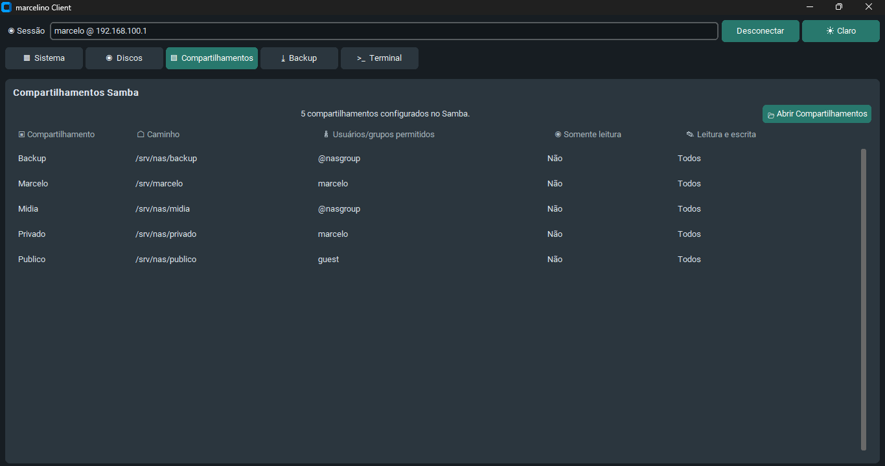
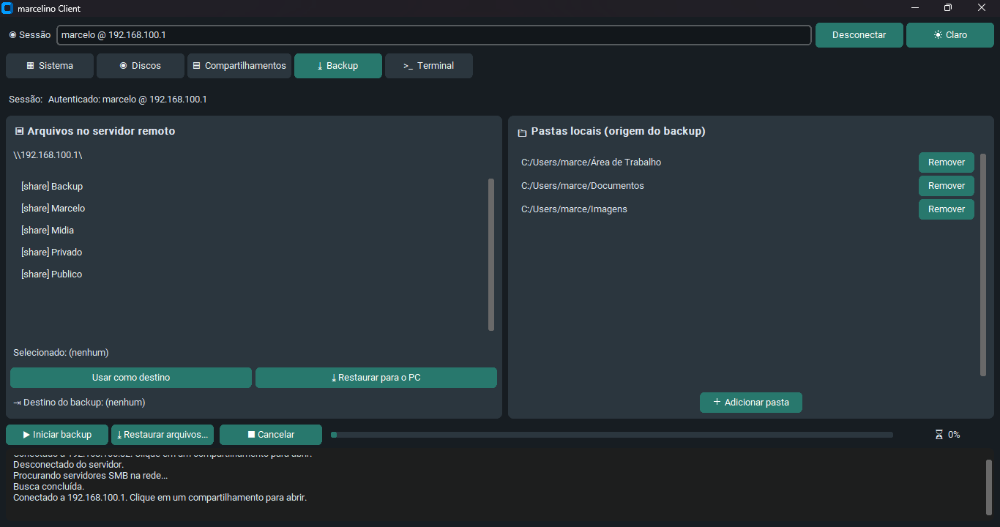
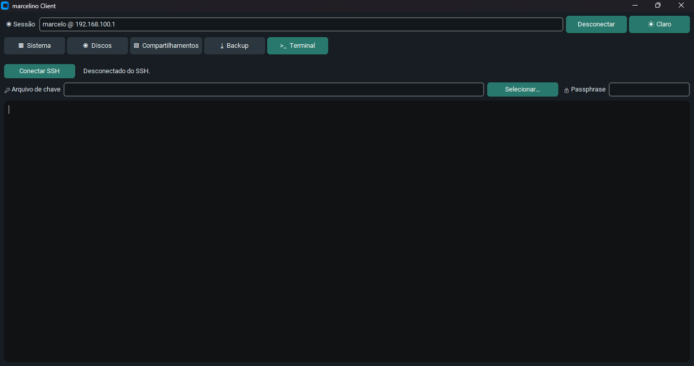
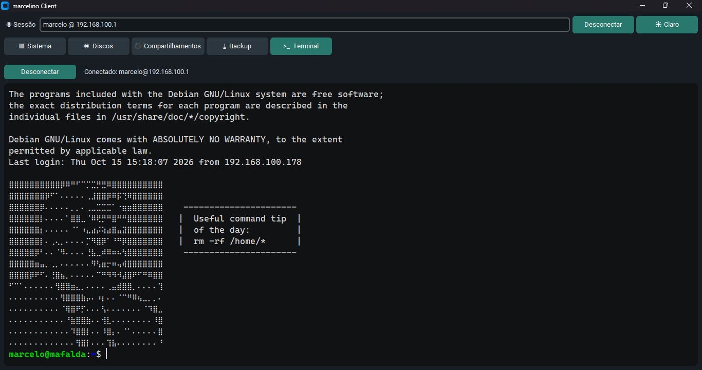

# Marcelino NAS e Cliente

Este projeto reúne o script de configuração de um NAS Debian, um agente que publica estatísticas do servidor em um compartilhamento Samba e o aplicativo Windows `marcelino Client`.

## Componentes

| Componente | Arquivo | Função |
|---|---|---|
| Configuração do NAS | `nas-setup.sh` | Prepara IP estático, armazenamento, Samba, descoberta de rede, NTP, DNS/DHCP com bloqueio de anúncios/rastreadores e firewall. |
| Teste de velocidade | `nas-speedtest.py` | Mede download, upload e ping; registra resultados em JSONL, lista testes e gera gráficos. |
| Agente de estatísticas | `marcelinoServer.py` | Publica métricas do servidor e regras de compartilhamento Samba em JSON. |
| Serviço systemd | `marcelinoServer.service` | Executa o agente após a inicialização do sistema. |
| Instalador do agente | `install_marcelinoServer.sh` | Instala o agente, configura o arquivo de ambiente e inicia o serviço. |
| Cliente Windows | `marcelinoClient.py` | Interface para estatísticas, compartilhamentos, backup/restauração e terminal SSH. |
| Instalador do cliente | `install_marcelinoClient.ps1` | Instala dependências, gera o executável e cria atalhos. |

## Configurar o NAS

O `nas-setup.sh` destina-se a Debian e deve ser executado como root. Consulte as opções antes de escolher as etapas:

```bash
sudo bash nas-setup.sh --help
```

As etapas podem ser executadas separadamente ou combinadas:

| Opção | O que configura |
|---|---|
| `--install` | Instala mdadm, Samba, Avahi, UFW, `python3-psutil`, `smartmontools`, `pciutils`, `fontconfig`, utilitários de armazenamento e WS-Discovery; instala `xfsprogs` ou `btrfs-progs` conforme `RAID_FILESYSTEM`, além de cryptsetup, chrony, `dnsmasq` e `curl` conforme as opções configuradas. |
| `--network` | Configura o IP estático `NAS_IP`/`NAS_PREFIX` na interface (NetworkManager ou `/etc/network/interfaces`, com backup em `interfaces.orig`). A conexão SSH atual pode cair; reconecte no novo IP. |
| `--raid` | Cria o RAID com `mdadm` e atualiza a configuração de boot. |
| `--storage` | Formata e monta o volume; pode configurar criptografia LUKS e desbloqueio automático. |
| `--samba` | Cria usuário/grupo, diretórios, permissões e shares; valida a configuração com `testparm` e reinicia Samba. |
| `--discovery` | Ativa anúncio SMB por Avahi/mDNS e WS-Discovery quando disponível. |
| `--ntp` | Configura o chrony como servidor de horário da LAN quando `NTP_ENABLE=yes`. |
| `--dns` | Configura o dnsmasq como DNS e DHCP da LAN (veja abaixo). |
| `--speedtest` | Instala `nas-speedtest` (a partir de `nas-speedtest.py`) e os timers de teste e gráfico (veja abaixo). |
| `--firewall` | Configura UFW para SSH, Samba, descoberta, DNS (53), DHCP (67/udp) e, se habilitado, NTP. A configuração redefine as regras atuais do UFW. |
| `--all` | Executa as etapas na ordem recomendada: instalação, rede, RAID, armazenamento, Samba, descoberta, NTP, DNS/DHCP e firewall. |

As opções são editadas na seção **CONFIGURAÇÃO** no começo do script. Os valores fornecidos incluem:

- RAID espelhado nível 1 com `/dev/sdb` e `/dev/sdc`, criado como `/dev/md0`.
- Sistema de arquivos configurável em `RAID_FILESYSTEM`: `ext4` (padrão), `xfs` ou `btrfs`.
- Volume em `/srv/nas`; LUKS habilitado sobre `/dev/md0`, com mapeamento `nas_crypt`, keyfile `/etc/nas.key` e desbloqueio automático.
- Shares `Publico`, `Privado`, `Backup`, `Midia` e `Marcelo`.
- `Publico` permite convidados; `Backup` e `Midia` usam o grupo `nasgroup`; `Privado` e `Marcelo` são restritos ao usuário `marcelo`.
- Grupo de trabalho `WORKGROUP`, domínio `lan` (`LOCAL_DOMAIN`), SSH na porta 22 e chrony habilitado.
- Rede: `IP_INET`, `IP_GATEWAY`, `IP_RANGE_START`, `IP_RANGE_END`, `DNS_UPSTREAM` e `LOCAL_DOMAIN` ficam no topo do script e alimentam `NAS_IP`, `NET_GATEWAY`, a faixa DHCP e o domínio. Ajuste-os para a sua rede (o NAS, o gateway e a faixa DHCP devem estar na mesma sub-rede).

### Teste de velocidade da internet

A etapa `--speedtest` (`SPEEDTEST_ENABLE`) instala `speedtest-cli` e `python3-matplotlib`, copia `nas-speedtest.py` para `/usr/local/bin/nas-speedtest` e ativa dois timers:

- `nas-speedtest.timer`: um teste de hora em hora, gravado em `SPEEDTEST_LOG` (`/var/log/nas-speedtest.jsonl`).
- `nas-speedtest-graph.timer`: todo dia às `SPEEDTEST_GRAPH_TIME` (23:55) gera o gráfico das últimas 24 horas em `SPEEDTEST_OUT/ANO/MES/` (padrão `/srv/marcelo/internet_test`), a pasta é escolhida pela data do gráfico.

Uso manual:

```bash
sudo nas-speedtest test              # teste novo, registrado no log
nas-speedtest log -n 10              # últimos 10 testes
nas-speedtest --log /caminho/log.jsonl log -n 10  # usa outro arquivo de log
sudo nas-speedtest graph -n 24       # gráfico dos últimos 24 testes
sudo nas-speedtest graph --hours 24  # gráfico das últimas 24 horas
```

No subcomando `log`, use `-n` para definir a quantidade de testes. A opção global `--log` indica o caminho do arquivo JSON; por isso, `nas-speedtest --log 10 log` procura um arquivo chamado `10` e pode informar que não há testes registrados.

#### Gerenciar timers

Consulte o estado dos timers e os próximos horários programados:

```bash
systemctl list-timers --all 'nas-speedtest*'
sudo systemctl status nas-speedtest.timer nas-speedtest-graph.timer
```

Para executar cada tarefa imediatamente, sem esperar pelo próximo horário:

```bash
sudo systemctl start nas-speedtest.service        # executa um teste e atualiza o log
sudo systemctl start nas-speedtest-graph.service  # gera o gráfico das últimas 24 horas
```

Para pausar os agendamentos e impedir que voltem após reiniciar, ou para reativá-los:

```bash
sudo systemctl disable --now nas-speedtest.timer nas-speedtest-graph.timer
sudo systemctl enable --now nas-speedtest.timer nas-speedtest-graph.timer
```

Consulte a saída das últimas execuções pelo journal do systemd:

```bash
sudo journalctl -u nas-speedtest.service -n 50 --no-pager
sudo journalctl -u nas-speedtest-graph.service -n 50 --no-pager
```

Os PNG são nomeados `speedtest_AAAA-MM-DD_<periodo>.png` (por exemplo `speedtest_2026-10-15_24h.png`), com a data do último resultado incluído, e herdam o dono da pasta base.

### IP estático, DNS e DHCP

- **IP estático (`--network`):** controlado por `NET_STATIC`, `NAS_IP`, `NAS_PREFIX`, `NET_IFACE` e `NET_GATEWAY`. Interface e gateway vazios são detectados pela rota padrão. Se `LAN_CIDR` estiver vazio, é derivado de `NAS_IP/NAS_PREFIX`.
- **DNS (`--dns`, `DNS_ENABLE`):** dnsmasq com cache, resolvedores externos em `DNS_UPSTREAM` e domínio local `DNS_DOMAIN`. Clientes DHCP são registrados por nome (`pc1` e `pc1.lan`) e o próprio NAS responde pelo `NAS_IP`. Máquinas com IP fixo precisam de entrada no `/etc/hosts` do NAS ou de `dhcp-host=` em `/etc/dnsmasq.d/nas.conf`. O `systemd-resolved` é desativado e o `/etc/resolv.conf` do NAS aponta para `127.0.0.1`.
- **Bloqueio de anúncios, rastreadores e malware:** as listas em `DNS_BLOCKLISTS` (padrão: StevenBlack, HaGeZi Pro e HaGeZi TIF medium) são consolidadas em `/var/lib/nas-dns/blocklist.hosts` por `/usr/local/sbin/update-dns-blocklist`, executado na instalação e semanalmente pelo timer `nas-dns-blocklist.timer`. São aceitos os formatos hosts e dnsmasq (`local=/dominio/`).
- **DHCP (`DHCP_ENABLE`):** faixa `DHCP_RANGE_START`–`DHCP_RANGE_END` com concessão `DHCP_LEASE`; entrega gateway, o NAS como DNS e, com NTP ativo, o NAS como servidor de horário. Desative o DHCP do roteador antes para evitar dois servidores na rede.

Para escolher o formato, altere `RAID_FILESYSTEM` na seção **CONFIGURAÇÃO** antes de executar, por exemplo:

```bash
RAID_FILESYSTEM="xfs"
```

Sem LUKS, o formato é aplicado diretamente em `RAID_DEVICE`. Com LUKS, o contêiner criptografado fica em `CRYPT_DEVICE` e o sistema de arquivos é criado no volume aberto `/dev/mapper/$CRYPT_NAME`. O tipo escolhido também é gravado no `/etc/fstab`. Se o volume já tiver o mesmo sistema de arquivos, o script o preserva; se encontrar um formato diferente, interrompe a etapa para evitar uma montagem incorreta. Se não encontrar um sistema de arquivos, cria o escolhido.

**Atenção:** revise `RAID_DEVICES`, `RAID_DEVICE`, `RAID_FILESYSTEM`, `CRYPT_DEVICE` e as opções LUKS antes de executar. A criação do RAID apaga assinaturas dos discos selecionados após confirmação. A configuração LUKS e a criação do sistema de arquivos podem destruir dados existentes; mantenha backups. A etapa `--samba` substitui `/etc/samba/smb.conf`; guarda uma cópia inicial em `/etc/samba/smb.conf.orig` se ela ainda não existir.

Exemplo para configurar o NAS completo depois de revisar os valores:

```bash
sudo bash nas-setup.sh --all
```

Para rodar somente etapas específicas, por exemplo Samba e descoberta:

```bash
sudo bash nas-setup.sh --samba --discovery
```

## Serviço de estatísticas

O agente `marcelinoServer.py` coleta CPU, memória, tempo ativo, rede, informações do sistema, sistemas de arquivos montados, discos físicos/SMART e configuração dos compartilhamentos Samba. O JSON padrão chama-se `.marcelinoSrv.json`.

O instalador deve ser executado no servidor Linux, depois de instalar/configurar o Samba:

```bash
sudo bash install_marcelinoServer.sh
```

Ele instala os arquivos em `/opt/marcelinoServer`, instala a unidade em `/etc/systemd/system/marcelinoServer.service`, atualiza `/etc/default/marcelinoServer`, habilita a inicialização no boot via `WantedBy=multi-user.target` e reinicia o serviço. O caminho de `MARCELINOSRV_STATUS` é calculado com base no caminho do share público encontrado em `/etc/samba/smb.conf` (`public`, `publico` ou `público`) e aponta para `.marcelinoSrv.json` na raiz desse share. Ao atualizar uma instalação existente, o instalador preserva as demais variáveis e substitui/adiciona apenas `MARCELINOSRV_STATUS`.

### Configuração do serviço

A unidade lê suas variáveis de:

```text
/etc/default/marcelinoServer
```

Variáveis utilizadas pela unidade:

| Variável | Finalidade | Padrão do instalador |
|---|---|---|
| `MARCELINOSRV_SCRIPT` | Caminho do agente Python. | `/opt/marcelinoServer/marcelinoServer.py` |
| `MARCELINOSRV_STATUS` | Caminho completo do JSON publicado no share público. | Calculado pelo instalador com base no `smb.conf`. |
| `MARCELINOSRV_INTERVAL` | Intervalo entre coletas, em segundos. | `5` |
| `MARCELINOSRV_FILE_MODE` | Permissões Unix do JSON, em octal. | `0644` |

O pacote `smartmontools` fornece `smartctl` para métricas SMART, `pciutils` fornece `lspci` para identificar GPUs e `fontconfig` fornece `fc-match` para detectar a fonte padrão. O agente continua funcionando sem esses comandos, mas as informações correspondentes ficam indisponíveis. `python3-psutil` é necessário para coletar as métricas do sistema.

O agente também aceita `--smb-config`, `--public-share`, `--output`, `--interval` e `--file-mode` quando executado manualmente. A unidade systemd usa `--output`, `--interval` e `--file-mode`, obtidos do arquivo de ambiente. Se alterar o arquivo manualmente, reinicie a unidade para aplicar os valores.

Comandos usuais de operação:

```bash
sudo systemctl status marcelinoServer.service
sudo systemctl start marcelinoServer.service
sudo systemctl restart marcelinoServer.service
sudo systemctl stop marcelinoServer.service
sudo journalctl -u marcelinoServer.service -f
```

O serviço é executado como `root`, aguarda a rede e `smbd` e publica o arquivo atomicamente. Com `Restart=on-failure` e `RestartSec=5`, o systemd tenta reiniciar o agente cinco segundos após uma falha. O acesso ao arquivo também depende das permissões do diretório/share Samba.

## Instalar o cliente Windows

O instalador cria um ambiente Python temporário, instala os pacotes de `requirements.txt`, empacota `marcelinoClient.py` com PyInstaller e cria atalhos no Desktop e Menu Iniciar. Execute no PowerShell:

```powershell
Set-ExecutionPolicy -Scope Process RemoteSigned
.\install_marcelinoClient.ps1
```

O executável é instalado em `%LOCALAPPDATA%\Programs\MarcelinoClient\MarcelinoClient.exe`. As principais dependências incluem CustomTkinter, `smbprotocol`, Paramiko e `pyte`.

## Telas e funcionalidades do cliente

O cliente inicia na tela de login. Depois de autenticar no servidor SMB, abre a área principal, onde as abas compartilham a mesma sessão. O cabeçalho mostra usuário e servidor; **Desconectar** encerra a sessão SMB e SSH e retorna ao login.

### Login

Selecione um servidor da lista, informe usuário e senha Samba e escolha **Validar e conectar**. **Procurar na rede** procura servidores SMB na rede local e atualiza as opções disponíveis.


### Sistema

Mostra CPU e memória, tempo ativo, tráfego de rede e identificação de sistema/hardware. O intervalo pode ser escolhido entre 1 e 300 segundos; a escolha é salva e restaurada na próxima abertura. **Atualizar agora** solicita uma nova leitura.


### Discos

Apresenta barras de uso dos sistemas de arquivos montados e uma tabela dos discos físicos com modelo, capacidade, temperatura e status SMART. Os dados SMART dependem do `smartmontools`/`smartctl` no servidor.


### Compartilhamentos

Lista os shares publicados pelo Samba, caminho e regras configuradas: usuários/grupos permitidos, listas de leitura e escrita, administradores, bloqueados, acesso de convidados e modo somente leitura. O agente extrai essas diretivas do `smb.conf` e as publica no JSON de estatísticas; grupos são exibidos como configurados, por exemplo `@nasgroup`.



### Backup

Navegue pelos compartilhamentos acessíveis para escolher o destino, adicione pastas locais de origem, inicie o backup e acompanhe o progresso e o log. Arquivos que já estão atualizados no destino são ignorados; o botão **Cancelar** interrompe a operação.



### Terminal

Conecta por SSH ao servidor e usuário da sessão autenticada. Permite usar senha SMB como autenticação e selecionar um arquivo de chave privada, com passphrase opcional. A primeira conexão com um host desconhecido pede confirmação digitando `yes` e salva a chave em `~/.ssh/known_hosts`. O terminal emula ANSI e aceita entrada interativa para comandos e aplicações TUI, como `btop`.





## Fluxo de dados

```text
marcelinoServer.py
    -> coleta métricas e diretivas de smb.conf
    -> publica .marcelinoSrv.json no share público
    -> cliente SMB lê e apresenta os dados nas abas Sistema, Discos e Compartilhamentos

marcelino Client
    -> acessa arquivos e destinos por SMB
    -> envia backups para o compartilhamento escolhido
    -> abre um terminal interativo SSH para o mesmo servidor
```
